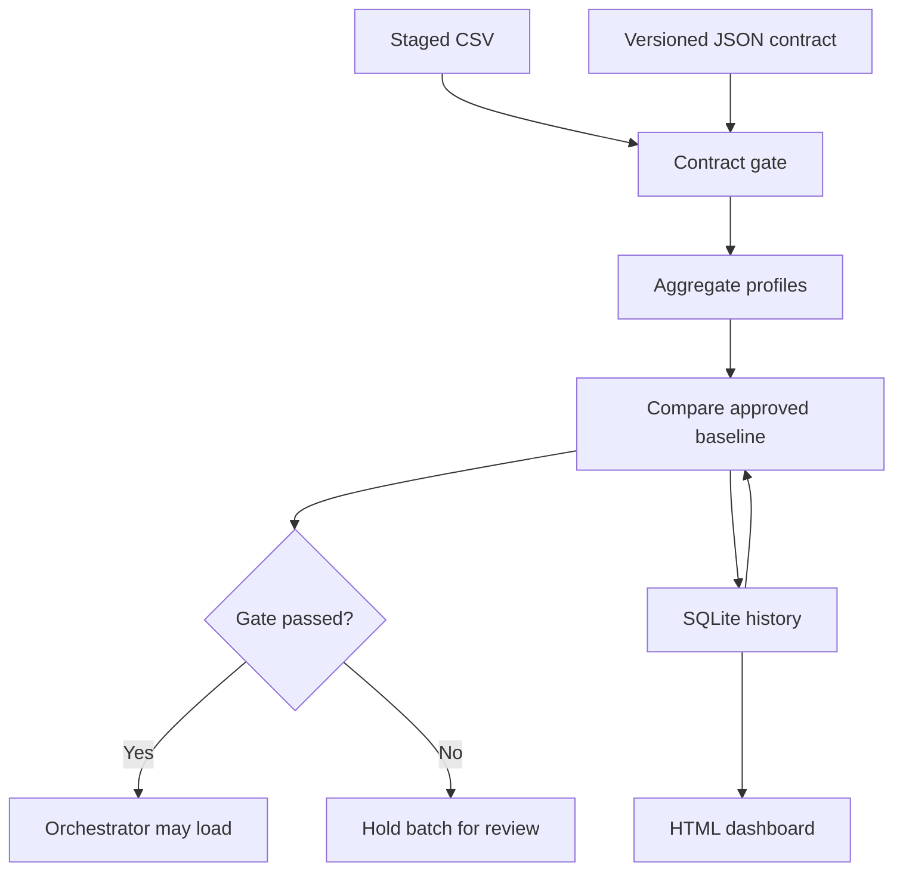

# Enterprise AI Data Readiness & Observability

An executable reference implementation for validating structured enterprise data before loading it into a warehouse, analytics pipeline or AI retrieval system. A quality gate rejects broken data contracts and unexpected distribution changes, while an audit history records what happened and why.

**Requirements:** Python 3.10+; standard library only. No cloud account, third-party packages, model API, or credentials.

## Run in two minutes

```bash
cd ai-readiness
python ai_readiness.py sample.csv contract.json
python demo.py demo-output
python -m unittest discover -v
```

The demonstration creates a new directory containing a SQLite history, three JSON reports, and an offline `dashboard.html`. Open the dashboard in any browser. Expected output:

| Batch | Outcome | Explanation |
| --- | --- | --- |
| baseline | PASS | Clean initial reference distribution |
| drift | FAIL | Valid rows but high-value orders and channel/category distributions shift |
| invalid | FAIL | Duplicate order-line key, invalid amounts and status, excess missing notes |

## Architecture



## Interfaces and contract rules

| Contract field | Purpose | Example |
| --- | --- | --- |
| dataset, version | Identity and revision | `"retail_orders", "1.0.0"` |
| schema | Declared column names | `["id", "amount"]` |
| allow_extra_columns | Reject undeclared columns if false | `false` |
| required | Nonblank fields | `["id"]` |
| unique | Unique nonblank single-column keys | `["id"]` |
| composite_keys | Unique nonblank combinations | `[["order_id", "line_id"]]` |
| numeric | Finite numbers within inclusive bounds | `{"amount":{"min":0,"max":100000}}` |
| allowed_values | Permitted nonblank text, matched case-sensitively | `{"status":["OPEN","PAID"]}` |
| freshness | Row timestamps within an age window (timezone required) | `{"column":"updated_at","max_age_hours":24}` |
| min_rows, max_rows | Batch size bounds | `100, 100000` |
| max_null_fraction | Maximum blank or missing fraction per column | `{"note":0.1}` |
| histograms | Fixed numeric bucket boundaries | `{"amount":[50,100,500]}` |
| drift | Thresholds for historical comparisons | `{"max_row_change":0.25,"max_distribution_distance":0.4}` |

Unknown contract keys, invalid thresholds, duplicate key declarations and rules outside declared schemas cause input errors. Whitespace around field values is stripped. CSV headers are matched exactly; blank physical lines are ignored by the CSV reader.

### Report semantics

* `passed`: true only when no enabled contract or drift rule fails.
* `rows`, `failed_rows`, `row_pass_rate`: a row is counted as failed once even if several rules fail. Batch-level schema, row-count, null-fraction and drift findings are not attributed to individual rows.
* `null_fraction`: blank/missing counts divided by batch rows for expected columns. Zero-row batches are governed by the row-count contract.
* `violations`: counts grouped by rule, without raw record values.
* `profile`: fixed-length numeric and categorical count vectors. Numeric buckets are intervals from negative infinity to the first edge, between edges, and from the final edge upward (left inclusive); blank and invalid values have separate final buckets. Categorical vectors follow the contract order, then unrecognized and blank buckets.
* `contract_hash`: SHA-256 of the canonical contract JSON, so incompatible versions/configurations never share an historical baseline.
* `drift`, `run_id`: historical comparison and audit record information when SQLite history is enabled.

### Historical monitoring and approvals

```bash
python ai_readiness.py demo_baseline.csv demo_contract.json --history retail.sqlite --report first.json
python ai_readiness.py demo_drift.csv demo_contract.json --history retail.sqlite --report second.json
python readiness_history.py retail.sqlite retail_orders
python readiness_dashboard.py retail.sqlite retail_orders retail-quality.html
```

Drift requires a history database. The first contract-valid batch creates the baseline automatically. Subsequent batches compare with that fixed reference; failed or passing batches do not move it. A new contract hash creates a separate baseline. Row-count change is absolute relative change; growth from a zero-row baseline is reported as undefined and triggers a configured row-count threshold. Distribution drift uses total variation distance, one half of the sum of absolute differences between normalized bucket frequencies. It ranges from 0 (same distribution) to 1 (no overlap).

After a data owner confirms an intentional change, an authorized operator can use `--promote-baseline` to adopt a new reference. The batch must still pass all regular contract checks, and overridden drift violations are retained in the audit record. Protect access to the baseline database and record the approval in the organization's ticketing system.

Exit codes: **0** passed, **1** quality/drift failure, **2** invalid input, I/O or configuration error. JSON reports are written to new files only; remove or rotate prior reports before reuse. If report writing fails after a history transaction has committed, its record remains available in SQLite.

## Project contents

| File | Responsibility |
| --- | --- |
| ai_readiness.py | Stream CSV, check rules, produce gate report |
| readiness_contract.py | Contract configuration validation and hash |
| readiness_profile.py | Aggregate histograms and compare distributions |
| readiness_history.py | Transactional audit trail and baseline management |
| readiness_dashboard.py | Offline HTML reporting |
| demo.py, demo_*.csv, demo_contract.json | Reproducible synthetic retail order scenarios |
| test_ai_readiness.py, test_demo.py | Rule, drift, CLI and integration tests |
| INTEGRATION.md | Pipeline deployment and operating guidance |
| snowflake_quality_example.sql | Warehouse-native structural quality example |

## Scope and scaling

This project is a local batch reference, not a deployed cloud service. CSV rows are streamed but unique-key sets grow with distinct keys; run large uniqueness checks inside the warehouse or distributed processing engine. Reports deliberately exclude raw data, but contract-defined labels and small aggregate counts can still be sensitive, so restrict access. Structural checks alone cannot prove factual accuracy, regulatory compliance, or AI response quality.
